#  Lietotāja ceļvedis "Wanderlist"
## Programmatūras palaišana

### Projekta iegūšāna

```
git clone https://github.com/23DP1KBelo/Celotajs.git
cd Celotajs
```

### Backend palaišana (Laravel)

Atver termināli un ievada komandu:

```
php artisan serve
```

Instalē nepieciešamās pakotnes:

```
composer install
```

Izveido `.env` failu:

```
cp .env.example .env
```

Ģenerē lietotnes atslēgu:

```bash
php artisan key:generate
```

Ja nepieciešams, konfigurē datubāzi `.env` failā un izpildi migrācijas:

```
php artisan migrate
```

Palaid backend serveri:

```
php artisan serve
```

Backend adrese: http://127.0.0.1:8000

### Frontend palaišana

Atver **jaunu termināli** un instele npm:

```
npm install
```

Palaid frontend serveri:

```
npm run dev
```

Frontend adrese ir: http://localhost:5173

Lai projekts darbotos, vienlaikus jābūt palaistiem abiem serveriem:

- **Backend:** `php artisan serve`
- **Frontend:** `npm run dev`

Katrs serveris jādarbina atsevišķā terminālī.
Lai apturētu serveri, attiecīgajā terminālī nospied:

```
Ctrl + C
```
## Programmas apraksts
### Reģistrēšanās

Reģistrēšanos lapu iespējams atrast sākuma lapas labajā stūrī.

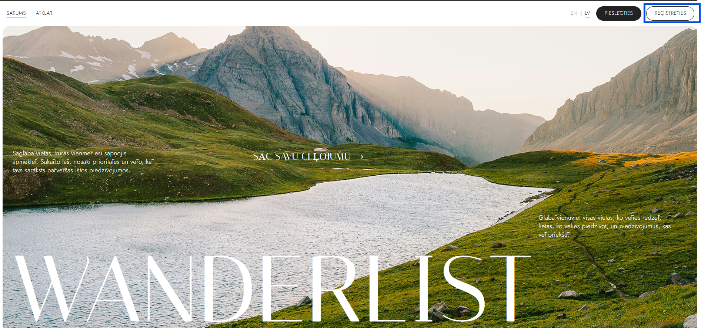

Lietotāja reģistrācijas lapa ir paredzēta jauna lietotāja konta izveidei ceļojumu plānošanas platformā **Wanderlist**. Reģistrējoties lietotājs iegūst iespēju saglabāt savus ceļojumu plānus un atgriezties pie tiem jebkurā laikā.

Lapas kreisajā pusē ir izvietots ainavas attēls ar platformas nosaukumu **WANDERLIST**, savukārt labajā pusē atrodas reģistrācijas forma.

#### Reģistrācijas soļi

1. **Lietotājvārds** – laukā „Tavs vārds” jāievada vēlamais lietotājvārds.
2. **E-pasts** – jāievada derīga e-pasta adrese, kas tiks izmantota lietotāja kontam.
3. **Parole** – jāizveido un jāievada parole konta aizsardzībai.
4. **Konta izveide** – pēc visu nepieciešamo lauku aizpildīšanas jānospiež poga **„IZVEIDOT KONTU”**.

#### Papildu navigācijas iespējas

- **„ATPAKAĻ UZ SĀKUMU”** – ļauj atgriezties platformas sākumlapā.
- **„PIESLĒGTIES”** – paredzēta lietotājiem, kuriem jau ir izveidots konts. Nospiežot šo saiti, iespējams pāriet uz pieslēgšanās lapu.

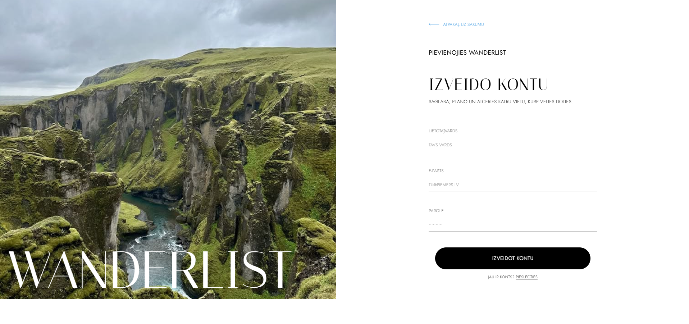

### Pieslēgšanās

Pieslēgšanās lapu iespējams atrast sākuma lapas labajā stūrī.

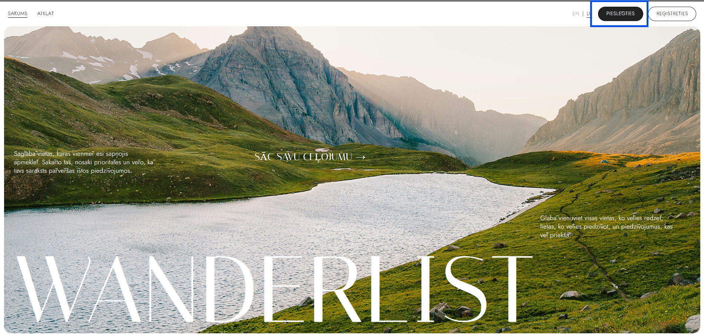

Lietotāja pieslēgšanās lapa ir paredzēta reģistrētu lietotāju autentifikācijai. Pieslēdzoties savam kontam, lietotājs var piekļūt iepriekš saglabātajiem ceļojumu plāniem un turpināt to pārvaldību.

Lapas kreisajā pusē ir izvietots ainavas attēls ar platformas nosaukumu **WANDERLIST**, savukārt labajā pusē atrodas pieslēgšanās forma.

#### Pieslēgšanās soļi

1. **Lietotājvārds** – laukā „Tavs lietotājvārds” jāievada reģistrācijas laikā norādītais lietotājvārds.
2. **Parole** – jāievada lietotāja kontam izveidotā parole.
3. **Pieslēgšanās** – pēc nepieciešamo lauku aizpildīšanas jānospiež poga **„PIESLĒGTIES”**.

#### Papildu navigācijas iespējas

- **„ATPAKAĻ UZ SĀKUMU”** – ļauj atgriezties platformas sākumlapā.
- **„IZVEIDOT KONTU”** – paredzēta lietotājiem, kuri vēl nav reģistrējušies platformā. Nospiežot šo saiti, iespējams pāriet uz reģistrācijas lapu.

Pēc veiksmīgas pieslēgšanās lietotājs iegūst piekļuvi savam **Wanderlist** kontam, kur iespējams apskatīt un pārvaldīt iepriekš saglabātos ceļojumu plānus.

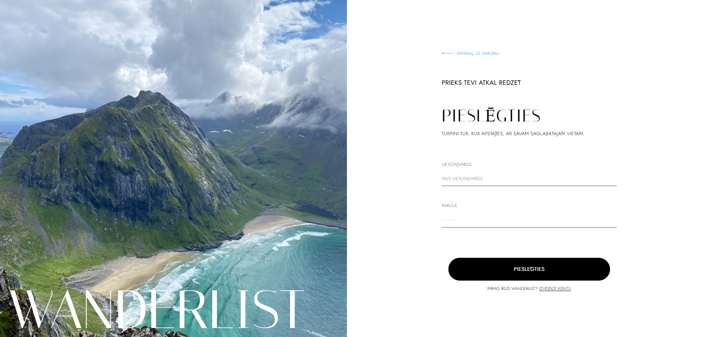

### Valodas maiņa

Wanderlist platformā lietotājam ir iespēja mainīt saskarnes valodu, izvēloties starp **latviešu** un **angļu** valodu. Valodas maiņas funkcija ļauj lietotājam izmantot platformu sev ērtākajā valodā.

Valodas izvēlne atrodas lapas augšējā labajā stūrī, navigācijas joslā, blakus pogai **„PIESLĒGTIES”**.

#### Valodas maiņas soļi

1. **Valodas izvēlne** – lapas augšējā labajā stūrī jāatrod valodu pārslēgšanas iespēja **„EN | LV”**.
2. **Valodas izvēle** – jānospiež uz vēlamās valodas apzīmējuma:
   - **LV** – latviešu valoda.
   - **EN** – angļu valoda.
3. **Valodas maiņa** – pēc valodas izvēles platformas saskarnes teksts tiek attēlots izvēlētajā valodā.

Pēc valodas maiņas **Wanderlist** platformas navigācijas elementi, pogas un citi saskarnes teksti tiek attēloti izvēlētajā valodā. Aktīvā valoda navigācijas joslā ir vizuāli izcelta ar pasvītrojumu.

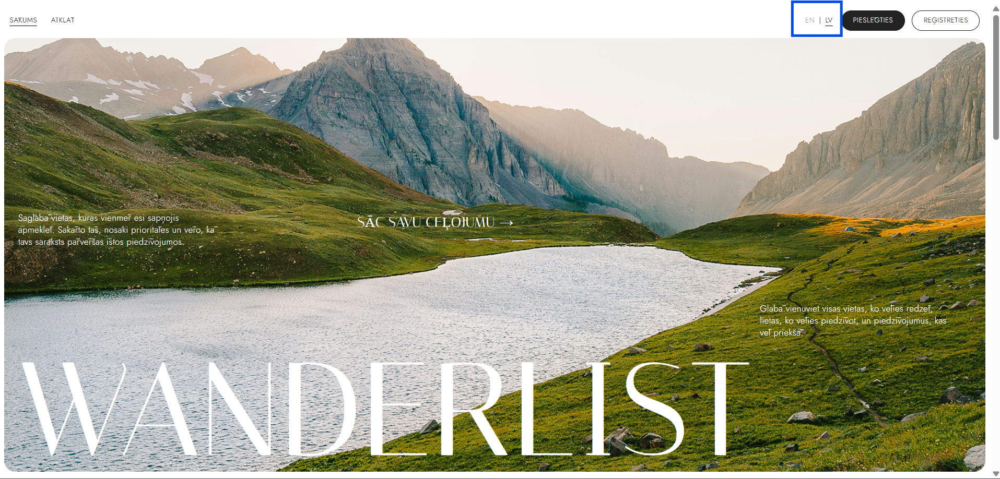

### Apskatīt rekomendētos galamērķus

Wanderlist platformā lietotājiem ir iespēja apskatīt ieteiktos ceļojumu galamērķus, lai gūtu iedvesmu nākamajiem ceļojumiem. Ieteiktajiem galamērķiem iespējams piekļūt divos veidos – sākumlapas karuselī un navigācijas sadaļā **„ATKLĀT”**.

#### **1. Ieteiktie galamērķi sākumlapas karuselī**

Sākumlapā, ritinot uz leju, atrodas sadaļa **„IETEIKTIE GALAMĒRĶI”**, kurā tiek attēloti dažādi ceļojumu galamērķi.

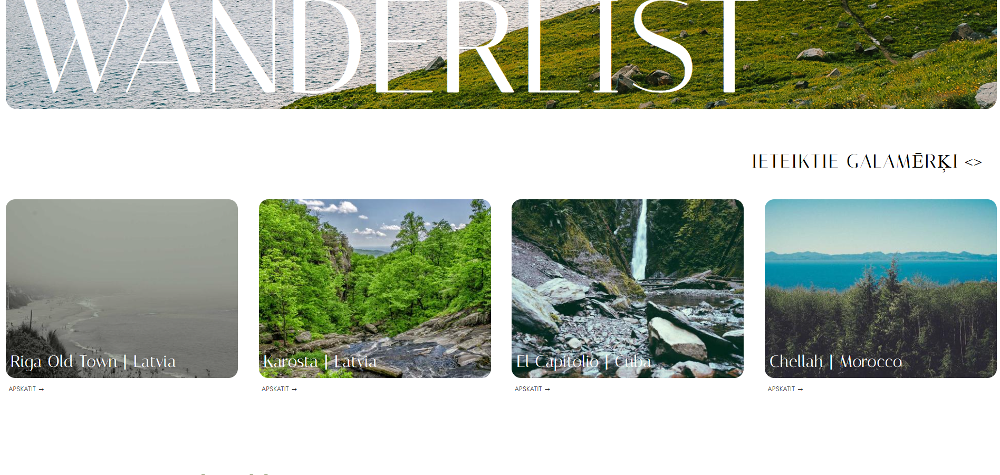

#### Galamērķu apskates soļi

1. **Sākumlapas atvēršana** – jāatver Wanderlist platformas sākumlapa.
2. **Ieteikto galamērķu atrašana** – ritinot lapu uz leju, jāatrod sadaļa **„IETEIKTIE GALAMĒRĶI”**.
3. **Karuseļa pārlūkošana** – izmantojot bultiņas, iespējams pārslēgties starp piedāvātajiem galamērķiem.
4. **Galamērķa izvēle** – zem izvēlētā galamērķa attēla jānospiež saite **„APSKATĪT →”**, lai atvērtu informāciju par visiem galamērķiem.

#### **2. Ieteiktie galamērķi navigācijas sadaļā „ATKLĀT”**

Otrs veids, kā apskatīt ceļojumu galamērķus, ir izmantot platformas galveno navigācijas izvēlni.
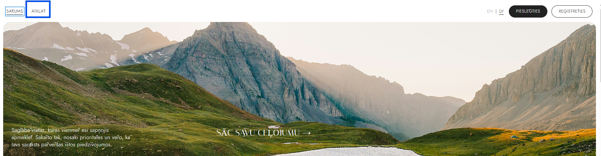
### Galamērķu apskates soļi

1. **Navigācijas izvēlne** – lapas augšējā kreisajā stūrī jāatrod navigācijas sadaļa **„ATKLĀT”**.
2. **Sadaļas atvēršana** – jānospiež uz **„ATKLĀT”**, lai pārietu uz galamērķu apskates lapu.
3. **Galamērķu pārlūkošana** – iespējams iepazīties ar platformā pieejamajiem ceļojumu galamērķiem.
4. **Galamērķa izvēle** – jāizvēlas interesējošais galamērķis, lai apskatītu detalizētāku informāciju par to.

### Meklēšana un filtrēšana
Wanderlist platformā lietotājiem ir iespēja meklēt un filtrēt ceļojumu galamērķus, lai ātrāk atrastu sev interesējošās vietas. Meklēšana ir pieejama sadaļā **„ATKLĀT”**, kurā tiek attēloti platformā pieejamie galamērķi.

Lapas augšdaļā atrodas meklēšanas lauks **„MEKLĒT GALAMĒRĶUS”**, zem kura ir izvietota kategoriju filtrēšanas izvēlne. Zem meklēšanas un filtrēšanas rīkiem tiek attēloti galamērķi kartīšu veidā ar attēlu, vietas nosaukumu, pilsētu un valsti.

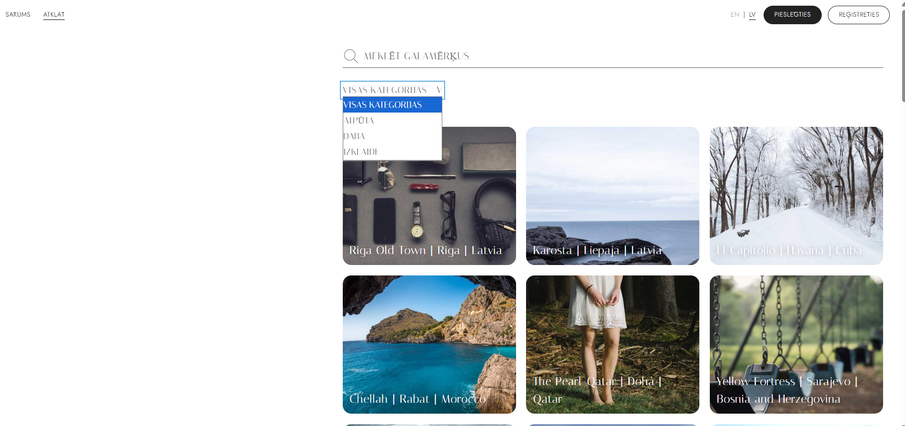

#### **1. Galamērķu meklēšana**

Meklēšanas funkcija ļauj atrast konkrētus galamērķus pēc valsts, pilsētas vai vietas nosaukuma.

#### Meklēšanas soļi:

1. **Meklēšanas lauks** – sadaļas „ATKLĀT” augšdaļā jāatrod meklēšanas lauks **„MEKLĒT GALAMĒRĶUS”**.
2. **Meklēšanas teksta ievadīšana** – jāievada vēlamais meklēšanas kritērijs:
   - **Valsts** – piemēram, „Latvia”, lai atrastu galamērķus Latvijā.
   - **Pilsēta** – piemēram, „Riga”, lai atrastu galamērķus Rīgā.
   - **Vietas nosaukums** – piemēram, „Karosta”, lai atrastu konkrēto vietu.
3. **Meklēšanas rezultāti** – tiek attēloti galamērķi, kas atbilst ievadītajam meklēšanas tekstam.
4. **Galamērķa izvēle** – jānospiež uz interesējošā galamērķa kartītes, lai apskatītu detalizētāku informāciju.

#### **2. Galamērķu filtrēšana pēc kategorijas**

Filtrēšanas funkcija ļauj atlasīt galamērķus pēc to kategorijas, atvieglojot piemērotu ceļojumu vietu atrašanu.

#### Filtrēšanas soļi:

1. **Kategoriju izvēlne** – zem meklēšanas lauka jāatrod nolaižamā izvēlne **„VISAS KATEGORIJAS”**.
2. **Kategorijas izvēle** – jānospiež uz izvēlnes un jāizvēlas viena no pieejamajām kategorijām:
   - **Visas kategorijas** – tiek attēloti visi pieejamie galamērķi.
   - **Atpūta** – galamērķi, kas piemēroti atpūtai.
   - **Daba** – dabas objekti un apskates vietas.
   - **Izklaide** – galamērķi, kas saistīti ar izklaides iespējām.
3. **Rezultātu filtrēšana** – pēc kategorijas izvēles tiek attēloti tikai tai atbilstošie galamērķi.
4. **Filtra atiestatīšana** – lai atkal apskatītu visus galamērķus, jāizvēlas **„VISAS KATEGORIJAS”**.

Lietotājs var vienlaikus izmantot meklēšanas lauku un kategoriju filtru, lai precizētu meklēšanas rezultātus.

### Galamērķu informācijas apskatīšana
Wanderlist platformā lietotājiem ir iespēja apskatīt detalizētu informāciju par izvēlēto ceļojuma galamērķi. Galamērķa apskates lapa ir pieejama gan reģistrētiem, gan nereģistrētiem lietotājiem.


Lapas augšdaļā tiek attēlots **galamērķa nosaukums**, pilsēta un valsts. Zem tā atrodas galamērķa attēls, īss apraksts un pamatinformācija.

#### Galamērķa apskates soļi:

1. **Galamērķa meklēšana** – sadaļā **„ATKLĀT”** jāatrod interesējošais galamērķis, izmantojot meklēšanas lauku, kategoriju filtrus vai pārlūkojot pieejamās vietas.
2. **Galamērķa izvēle** – jānospiež uz izvēlētā galamērķa kartītes.
3. **Detalizētas informācijas apskate** – tiek atvērta galamērķa lapa, kurā pieejama šāda informācija:
   - **Nosaukums** – izvēlētā galamērķa nosaukums.
   - **Attēls** – galamērķa vizuālais attēlojums.
   - **Apraksts** – īsa informācija par apskates vietu.
   - **Valsts** – valsts, kurā atrodas galamērķis.
   - **Pilsēta** – pilsēta, kurā atrodas galamērķis.
   - **Kategorija** – galamērķa veids, piemēram, daba, atpūta vai izklaide.

Ja lietotājs nav pieslēdzies sistēmā viņam nav tiesību izmantot pogu "Pievienot manam sarakstam."

### Lietotāja statistikas apskate

Wanderlist platformā reģistrētiem lietotājiem ir pieejama personīgā profila sadaļa, kurā iespējams apskatīt informāciju par savu kontu un ceļojumu statistiku. Statistika sniedz pārskatu par saglabātajiem galamērķiem, apmeklētajām vietām un valstīm.

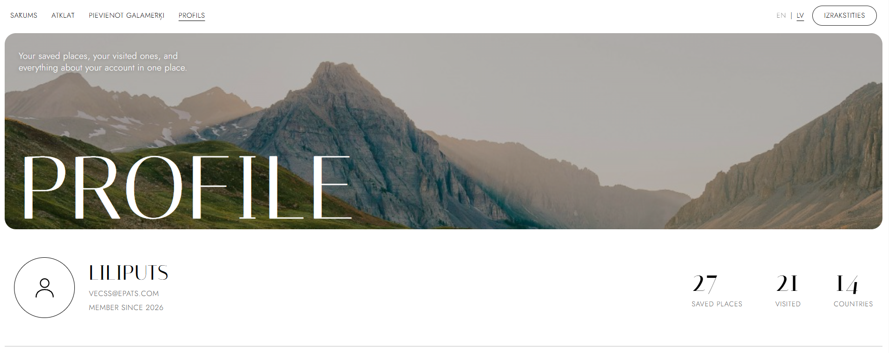

Profila lapai iespējams piekļūt, galvenajā navigācijas joslā izvēloties sadaļu **„PROFILS”**.

#### Apskates soļi:

1. **Pieslēgšanās kontam** – lietotājam jāpieslēdzas savam Wanderlist kontam.
2. **Profila atvēršana** – navigācijas joslā jānospiež uz sadaļas **„PROFILS”**.
3. **Lietotāja informācija** – profila lapā tiek attēlots lietotājvārds, e-pasta adrese un konta izveides gads.
4. **Statistikas apskate** – profila augšējā daļā tiek attēloti trīs galvenie statistikas rādītāji:
   - **Saved Places (Saglabātās vietas)** – kopējais galamērķu skaits, ko lietotājs ir pievienojis savam personīgajam sarakstam.
   - **Visited (Apmeklētās vietas)** – kopējais galamērķu skaits, kurus lietotājs ir atzīmējis kā apmeklētus.
   - **Countries (Valstis)** – kopējais unikālo valstu skaits, kurās atrodas lietotāja apmeklētie galamērķi.

### Ceļojumu pārvaldība
Wanderlist platformā reģistrētiem lietotājiem ir iespēja apskatīt, filtrēt, izveidot un dzēst savus ceļojumus. Visi lietotāja izveidotie ceļojumi ir pieejami profila sadaļā **„MY TRIPS” (Mani ceļojumi)**.

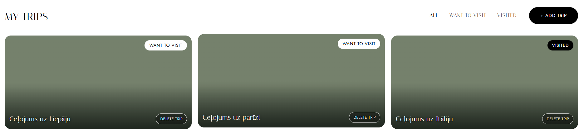

Ceļojumi tiek attēloti kartīšu veidā, kur redzams ceļojuma nosaukums, statuss un dzēšanas poga.

#### **1. Savu ceļojumu apskate**

#### Apskates soļi:

1. **Pieslēgšanās kontam** – lietotājam jāpieslēdzas savam Wanderlist kontam.
2. **Profila atvēršana** – galvenajā navigācijas joslā jāizvēlas sadaļa **„PROFILS”**.
3. **Ceļojumu sadaļas atrašana** – profila lapā jāatrod sadaļa **„MY TRIPS”**.
4. **Ceļojumu apskate** – tiek attēloti visi lietotāja izveidotie ceļojumi ar to nosaukumiem un statusiem.

#### **2. Ceļojumu filtrēšana**

Sadaļā **„MY TRIPS”** lietotājs var filtrēt savus ceļojumus pēc to statusa.

#### Filtrēšanas soļi:

1. Sadaļas augšējā labajā pusē jāatrod filtrēšanas izvēlne.
2. Jāizvēlas viens no pieejamajiem filtriem:
   - **ALL (Visi)** – tiek attēloti visi lietotāja izveidotie ceļojumi.
   - **WANT TO VISIT (Vēlos apmeklēt)** – tiek attēloti plānotie ceļojumi.
   - **VISITED (Apmeklētie)** – tiek attēloti ceļojumi, kas jau ir īstenoti.
3. Pēc filtra izvēles tiek attēloti tikai atbilstošie ceļojumi.

#### **3. Jauna ceļojuma izveide**

Lietotājam ir iespēja izveidot jaunu ceļojumu, izmantojot pogu **„+ ADD TRIP”**.

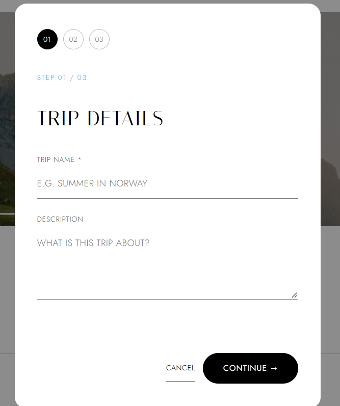

#### Izveides soļi:

1. **Jauna ceļojuma pievienošana** – sadaļas „MY TRIPS” augšējā labajā stūrī jānospiež poga **„+ ADD TRIP”**.
2. **Ceļojuma izveide** – jāaizpilda jaunā ceļojuma izveidei nepieciešamā informācija.
3. **Saglabāšana** – pēc ceļojuma izveides tas tiek pievienots lietotāja personīgajam ceļojumu sarakstam.

#### **4. Ceļojuma dzēšana**

Lietotājs var dzēst iepriekš izveidotus ceļojumus, kuri vairs nav nepieciešami.

#### Dzēšanas soļi:

1. **Ceļojuma atrašana** – sadaļā „MY TRIPS” jāatrod ceļojums, kuru nepieciešams dzēst.
2. **Dzēšanas poga** – izvēlētā ceļojuma kartītes apakšējā labajā stūrī jānospiež **„DELETE TRIP”**.
3. **Ceļojuma dzēšana** – izvēlētais ceļojums tiek noņemts no lietotāja ceļojumu saraksta.

### **4. Ceļojuma statusa maiņa**
Ceļojuma statusa maiņa ir pieejama lietotāja profila sadaļā **„MY TRIPS” (Mani ceļojumi)**. 
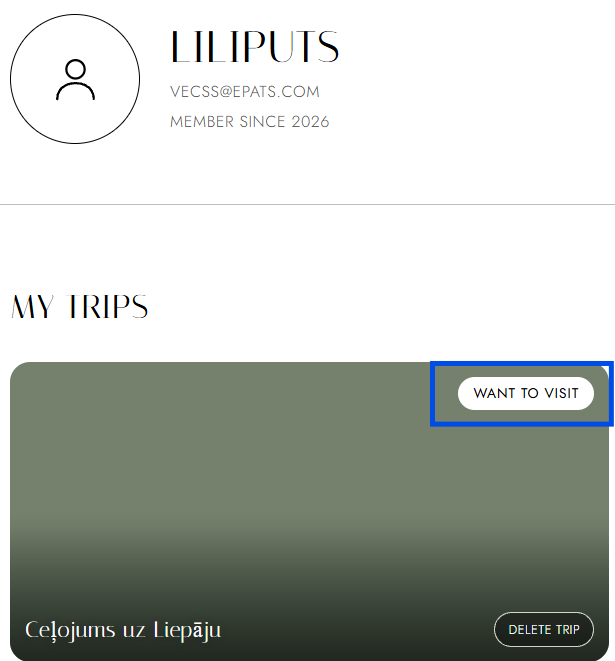
Katra ceļojuma kartītes augšējā labajā stūrī tiek attēlots tā pašreizējais statuss.
#### **1. Ceļojuma statusa maiņa**
#### Statusa maiņas soļi:
1. **Pieslēgšanās kontam** – lietotājam jāpieslēdzas savam Wanderlist kontam.
2. **Profila atvēršana** – galvenajā navigācijas joslā jāizvēlas sadaļa **„PROFILS”**.
3. **Ceļojumu sadaļas atrašana** – profila lapā jāatrod sadaļa **„MY TRIPS”**.
4. **Ceļojuma izvēle** – jāatrod ceļojums, kura statusu nepieciešams mainīt.
5. **Statusa maiņa** – ceļojuma kartītes augšējā labajā stūrī jānospiež uz pašreizējā statusa.
6. **Statusa atjaunināšana** – ceļojuma statuss tiek pārslēgts uz otru pieejamo statusu.

#### **2. Pieejamie ceļojuma statusi**

Katram ceļojumam iespējams piešķirt vienu no diviem statusiem:

- **„WANT TO VISIT” (Vēlos apmeklēt)** – norāda, ka ceļojums vēl tiek plānots un nav īstenots.
- **„VISITED” (Apmeklēts)** – norāda, ka ceļojums jau ir īstenots.

Nospiežot uz statusa pogas, iespējams pārslēgties starp šiem diviem statusiem.

### Ceļojuma apskate
Wanderlist platformā reģistrētiem lietotājiem ir iespēja apskatīt detalizētu informāciju par saviem izveidotajiem ceļojumiem. Ceļojuma detalizētās apskates lapā tiek attēlota visa ar ceļojumu saistītā informācija, kā arī tam pievienotās apskates vietas.

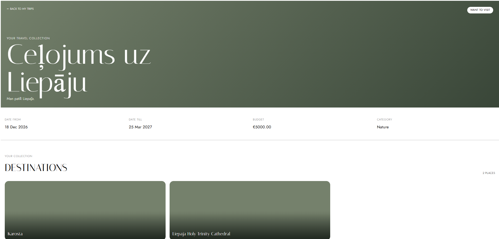

Ceļojuma detalizētajai informācijai iespējams piekļūt lietotāja profila sadaļā **„MY TRIPS” (Mani ceļojumi)**.

#### **1. Ceļojuma detalizēta apskate**

#### Apskates soļi:

1. **Profila atvēršana** – galvenajā navigācijas joslā jāizvēlas sadaļa **„PROFILS”**.
2. **Ceļojumu sadaļas atrašana** – profila lapā jāatrod sadaļa **„MY TRIPS”**, kurā tiek attēloti visi lietotāja izveidotie ceļojumi.
3. **Ceļojuma izvēle** – jānospiež uz interesējošā ceļojuma kartītes.
4. **Detalizētas informācijas apskate** – tiek atvērta izvēlētā ceļojuma lapa, kurā pieejama šāda informācija:
   - **Ceļojuma nosaukums** – lietotāja piešķirtais ceļojuma nosaukums.
   - **Apraksts** – īss ceļojuma apraksts.
   - **Statuss** – norāda, vai ceļojums ir plānots (**WANT TO VISIT**) vai jau īstenots (**VISITED**).
   - **Sākuma datums (DATE FROM)** – plānotais ceļojuma sākuma datums.
   - **Beigu datums (DATE TILL)** – plānotais ceļojuma beigu datums.
   - **Budžets (BUDGET)** – ceļojumam paredzētais budžets.
   - **Kategorija (CATEGORY)** – ceļojuma kategorija, piemēram, daba, atpūta vai izklaide.

#### **2. Ceļojumam pievienoto apskates vietu apskate**

Ceļojuma detalizētās informācijas lapas apakšdaļā atrodas sadaļa **„DESTINATIONS” (Galamērķi)**, kurā tiek attēlotas visas konkrētajam ceļojumam pievienotās apskates vietas.

#### Apskates soļi:

1. **Apskates vietu sadaļas atrašana** – ceļojuma lapā jāatrod sadaļa **„DESTINATIONS”**.
2. **Vietu pārlūkošana** – tiek attēlotas visas ceļojumam pievienotās apskates vietas kartīšu veidā ar to nosaukumiem un attēliem.
3. **Apskates vietas izvēle** – jānospiež uz interesējošās apskates vietas kartītes.
4. **Detalizētas informācijas apskate** – tiek atvērta izvēlētās vietas informācijas lapa, kurā iespējams apskatīt:
   - Apskates vietas nosaukumu.
   - Vietas attēlu.
   - Īsu vietas aprakstu.
   - Valsti, kurā atrodas apskates vieta.
   - Pilsētu, kurā atrodas apskates vieta.
   - Apskates vietas kategoriju.

#### **3. Atgriešanās pie ceļojumu saraksta**

Ceļojuma detalizētās apskates lapas augšējā kreisajā stūrī atrodas saite **„← BACK TO MY TRIPS”**.

Nospiežot šo saiti, lietotājs var atgriezties pie savu ceļojumu saraksta un izvēlēties citu ceļojumu apskatei.

### Profila rediģēšana un dzēšana

Wanderlist platformā reģistrētiem lietotājiem ir iespēja rediģēt sava konta informāciju, kā arī nepieciešamības gadījumā dzēst savu kontu. 


Profila rediģēšanas sadaļā **„ACCOUNT DETAILS” (Konta informācija)** iespējams mainīt e-pasta adresi un paroli, savukārt lietotājvārds nav rediģējams.

#### **1. Profila informācijas rediģēšana**

#### Rediģēšanas soļi:

1. **Pieslēgšanās kontam** – lietotājam jāpieslēdzas savam Wanderlist kontam.
2. **Profila atvēršana** – galvenajā navigācijas joslā jāizvēlas sadaļa **„PROFILS”**.
3. **Konta informācijas atrašana** – profila lapā jāatrod sadaļa **„ACCOUNT DETAILS”**, kurā tiek attēlota lietotāja konta informācija.
4. **Informācijas rediģēšana** – sadaļā pieejami šādi lauki:
   - **Username (Lietotājvārds)** – tiek attēlots reģistrācijas laikā izvēlētais lietotājvārds. Šis lauks nav rediģējams.
   - **Email (E-pasts)** – lietotājs var mainīt savu e-pasta adresi.
   - **New Password (Jaunā parole)** – lietotājs var ievadīt jaunu paroli, lai aizstātu esošo.
5. **Izmaiņu saglabāšana** – pēc nepieciešamo izmaiņu veikšanas jānospiež poga **„SAVE CHANGES” (Saglabāt izmaiņas)**.

#### **2. Lietotāja konta dzēšana**

Lietotājam ir iespēja dzēst savu Wanderlist kontu, izmantojot konta informācijas sadaļā pieejamo dzēšanas funkciju.

#### Konta dzēšanas soļi:

1. **Profila atvēršana** – galvenajā navigācijas joslā jāizvēlas sadaļa **„PROFILS”**.
2. **Konta informācijas atrašana** – jāatrod sadaļa **„ACCOUNT DETAILS”**.
3. **Dzēšanas pogas izvēle** – zem konta informācijas laukiem jānospiež **„DELETE ACCOUNT” (Dzēst kontu)**.
4. **Konta dzēšana** – tiek uzsākts lietotāja konta dzēšanas process.

**Svarīgi:** Pirms konta dzēšanas lietotājam jāpārliecinās, ka konts un ar to saistītā informācija vairs nav nepieciešama.


### Galamērķu filtrēšana pēc apmeklējuma statusa

Wanderlist platformā reģistrētiem lietotājiem sadaļā **„ATKLĀT”** ir pieejama papildu filtrēšanas funkcija, kas ļauj atlasīt galamērķus pēc to apmeklējuma statusa. Atšķirībā no nereģistrētiem lietotājiem, kuri var meklēt galamērķus un filtrēt tos pēc kategorijas, reģistrēti lietotāji var izmantot arī **statusa filtru**.

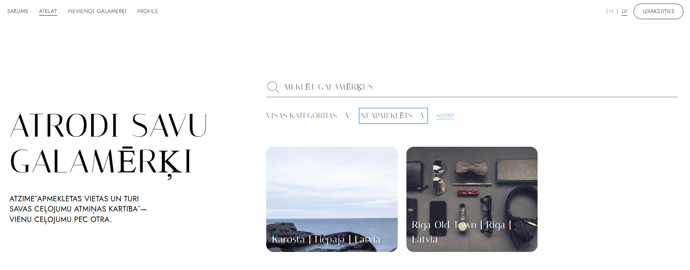


Statusa filtrēšana tiek veikta, pamatojoties uz konkrētā lietotāja ceļojumiem un tiem pievienotajiem galamērķiem.

#### **1. Galamērķu filtrēšana pēc statusa**

#### Filtrēšanas soļi:

1. **Pieslēgšanās kontam** – lietotājam jāpieslēdzas savam Wanderlist kontam.
2. **Sadaļas atvēršana** – galvenajā navigācijas joslā jāizvēlas sadaļa **„ATKLĀT”**.
3. **Statusa filtra atrašana** – zem meklēšanas lauka, blakus kategoriju filtram, atrodas apmeklējuma statusa izvēlne.
4. **Statusa izvēle** – jānospiež uz statusa izvēlnes un jāizvēlas viens no pieejamajiem filtriem:
   - **Visi statusi** – tiek attēloti galamērķi neatkarīgi no to apmeklējuma statusa.
   - **Apmeklēts** – tiek attēloti galamērķi, kurus lietotājs savos ceļojumos ir atzīmējis kā apmeklētus.
   - **Neapmeklēts** – tiek attēloti galamērķi, kurus lietotājs savos ceļojumos vēl nav atzīmējis kā apmeklētus.
5. **Rezultātu apskate** – pēc statusa izvēles tiek attēloti galamērķi, kas atbilst izvēlētajam filtram.

#### **2. Statusa filtrēšanas darbības princips**

Statusa filtrēšana ir individuāla katram reģistrētajam lietotājam. Tas nozīmē, ka filtrēšanas rezultāti tiek noteikti, ņemot vērā konkrētā lietotāja izveidotos ceļojumus un tajos iekļautos galamērķus.

**Svarīgi:** Ja viens un tas pats galamērķis ir pievienots vairākiem lietotāja ceļojumiem, tas filtrēšanas rezultātos var parādīties vairākas reizes. Katrs ieraksts tiek attēlots atbilstoši konkrētajam ceļojumam un tajā norādītajam apmeklējuma statusam.

Piemēram, ja lietotājs galamērķi **„Karosta”** ir pievienojis diviem dažādiem ceļojumiem, tas rezultātos var tikt attēlots divas reizes.

#### **3. Filtru apvienošana un atiestatīšana**

Lietotājs var vienlaikus izmantot vairākus filtrēšanas kritērijus, lai precizētu rezultātus.

#### Filtrēšanas soļi:

1. **Meklēšana** – meklēšanas laukā jāievada valsts, pilsētas vai vietas nosaukums.
2. **Kategorijas izvēle** – jāizvēlas vēlamā galamērķa kategorija.
3. **Statusa izvēle** – jāizvēlas apmeklējuma statuss.
4. **Rezultātu apskate** – tiek attēloti galamērķi, kas atbilst izvēlētajiem kritērijiem.
5. **Filtru atiestatīšana** – nospiežot **„NOTĪRĪT”**, tiek atiestatīti izvēlētie filtrēšanas kritēriji.


### Apskates vietas pievienošana savam ceļojumam

Wanderlist platformā reģistrētiem lietotājiem ir iespēja pievienot izvēlētās apskates vietas saviem izveidotajiem ceļojumiem. Šī funkcija ļauj organizēt ceļojumu plānus un saglabāt interesējošos galamērķus konkrētos ceļojumos.

Apskates vietas pievienošana ir pieejama galamērķa detalizētās apskates lapā, nospiežot pogu **„+ PIEVIENOT MANAM SARAKSTAM”**.

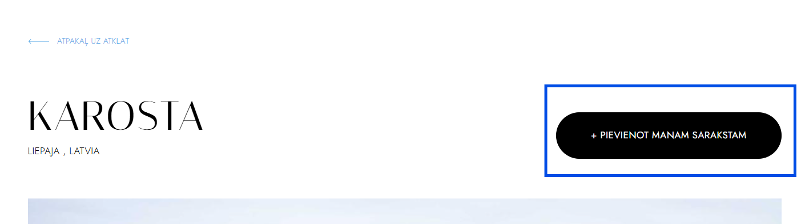

#### **1. Ceļojuma izvēle**
#### Pievienošanas soļi:

1. **Galamērķa izvēle** – sadaļā **„ATKLĀT”** jāatrod un jāatver interesējošās apskates vietas detalizētās informācijas lapa.
2. **Pievienošanas pogas nospiešana** – jānospiež poga **„+ PIEVIENOT MANAM SARAKSTAM”**.
3. **Ceļojuma izvēles logs** – tiek atvērts logs **„CHOOSE YOUR TRIP” (Izvēlies savu ceļojumu)**, kurā attēloti lietotāja izveidotie ceļojumi.

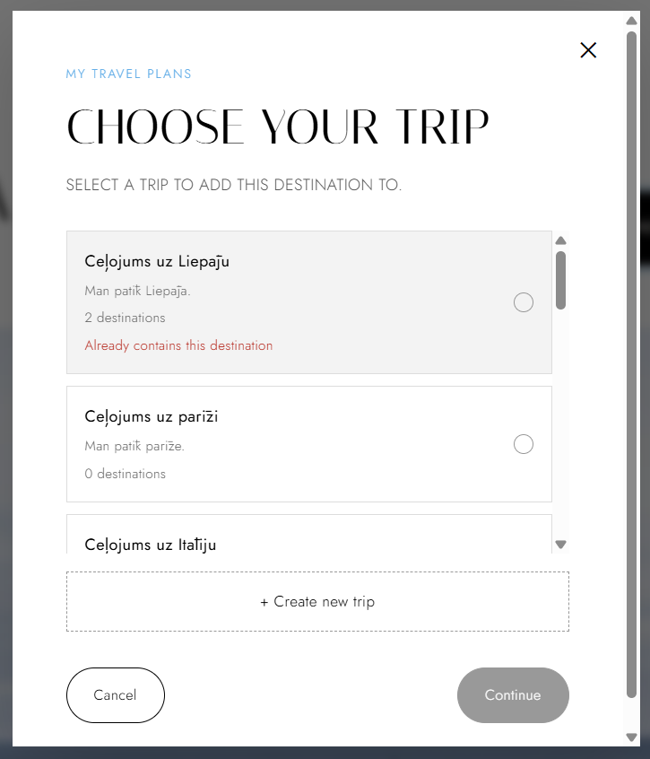
4. **Ceļojumu pārlūkošana** – katram ceļojumam tiek attēlota šāda informācija:
   - **Ceļojuma nosaukums** – lietotāja piešķirtais nosaukums.
   - **Apraksts** – īss ceļojuma apraksts.
   - **Galamērķu skaits** – ceļojumam jau pievienoto apskates vietu skaits.
5. **Ceļojuma izvēle** – jāatzīmē ceļojums, kuram lietotājs vēlas pievienot izvēlēto apskates vietu vai jaizveido jauns ceļojums.
6. **Turpināšana** – pēc ceļojuma izvēles jānospiež poga **„Continue” (Turpināt)**.

**Svarīgi:** Ja izvēlētā apskates vieta jau ir pievienota konkrētajam ceļojumam, tiek parādīts paziņojums **„Already contains this destination” (Šis galamērķis jau ir pievienots)**, lai novērstu vienas un tās pašas vietas atkārtotu pievienošanu vienam ceļojumam.

#### **2. Jauna ceļojuma izveide**

Ja lietotājs vēlas pievienot apskates vietu jaunam ceļojumam, to iespējams izveidot tieši ceļojuma izvēles logā.

#### Izveides soļi:

1. Ceļojuma izvēles logā jānospiež poga **„+ Create new trip” (Izveidot jaunu ceļojumu)**.
2. Jāaizpilda jaunā ceļojuma izveidei nepieciešamā informācija.
3. Pēc ceļojuma izveides to iespējams izmantot izvēlētās apskates vietas saglabāšanai.

#### **3. Apskates vietas saglabāšanas veida izvēle**

Pēc ceļojuma izvēles tiek atvērts nākamais logs **„SAVE YOUR DESTINATION” (Saglabā savu galamērķi)**.

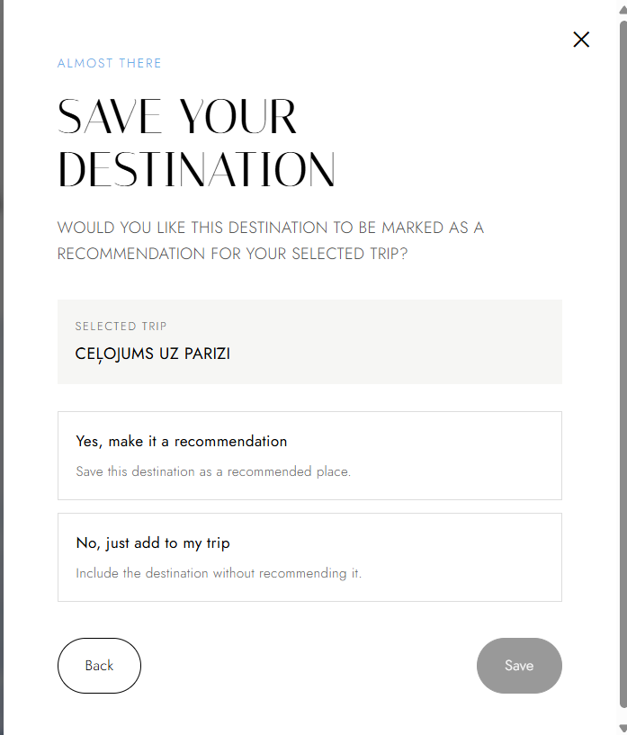

Šajā solī lietotājam jānorāda, vai pievienotā apskates vieta būs arī ieteikums un tiks paradīts citiem lietotājiem.

#### Saglabāšanas soļi:

1. **Izvēlētā ceļojuma pārbaude** – logā tiek attēlots izvēlētā ceļojuma nosaukums.
2. **Saglabāšanas veida izvēle** – lietotājam jāizvēlas viena no divām iespējām:
   - **„Yes, make it a recommendation” (Jā, pievienot kā ieteikumu)** – apskates vieta tiek pievienota ceļojumam un atzīmēta kā ieteikta vieta.
   - **„No, just add to my trip” (Nē, tikai pievienot ceļojumam)** – apskates vieta tiek pievienota izvēlētajam ceļojumam bez ieteikuma statusa.
3. **Saglabāšana** – pēc izvēles veikšanas jānospiež poga **„Save” (Saglabāt)**.

#### **4. Papildu navigācijas iespējas**

- **„Cancel” (Atcelt)** – ļauj pārtraukt apskates vietas pievienošanas procesu.
- **„Back” (Atpakaļ)** – ļauj atgriezties pie iepriekšējā soļa un mainīt izvēlēto ceļojumu.
- **„X” (Aizvērt)** – ļauj aizvērt pievienošanas logu.

### Izveidot galamērķi

Wanderlist platformā reģistrētiem lietotājiem ir iespēja pievienot jaunus ceļojumu galamērķus. Šī funkcija ļauj lietotājiem dalīties ar interesantām apskates vietām un pievienot tās saviem ceļojumiem.

Jauna galamērķa izveide ir pieejama galvenajā navigācijas joslā, izvēloties sadaļu **„PIEVIENOT GALAMĒRĶI”**.

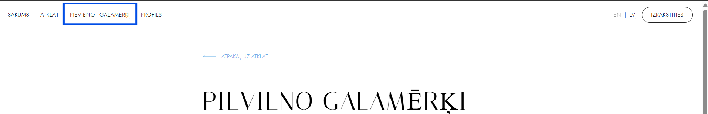

#### **1. Galamērķa izveides formas atvēršana**

#### Darbību soļi:

1. **Pieslēgšanās kontam** – lietotājam jāpieslēdzas savam Wanderlist kontam.
2. **Sadaļas atvēršana** – galvenajā navigācijas joslā jānospiež **„PIEVIENOT GALAMĒRĶI”**.
3. **Galamērķa izveides forma** – tiek atvērta lapa, kurā lietotājs var ievadīt informāciju par jaunu apskates vietu.

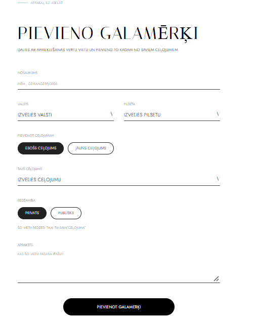

#### **2. Galamērķa informācijas ievadīšana**

Galamērķa izveides formā lietotājam jānorāda informācija par pievienojamo apskates vietu.

#### Formas aizpildīšanas soļi:

1. **Nosaukums** – laukā „NOSAUKUMS” jāievada apskates vietas nosaukums.
2. **Valsts** – nolaižamajā izvēlnē „IZVĒLIES VALSTI” jāizvēlas valsts, kurā atrodas apskates vieta.
3. **Pilsēta** – nolaižamajā izvēlnē „IZVĒLIES PILSĒTU” jāizvēlas pilsēta, kurā atrodas galamērķis.
4. **Pievienošana ceļojumam** – jāizvēlas viena no iespējām:
   - **„ESOŠS CEĻOJUMS”** – ļauj pievienot galamērķi kādam no lietotāja jau izveidotajiem ceļojumiem.
   - **„JAUNS CEĻOJUMS”** – ļauj izveidot jaunu ceļojumu, kuram pievienot galamērķi.
   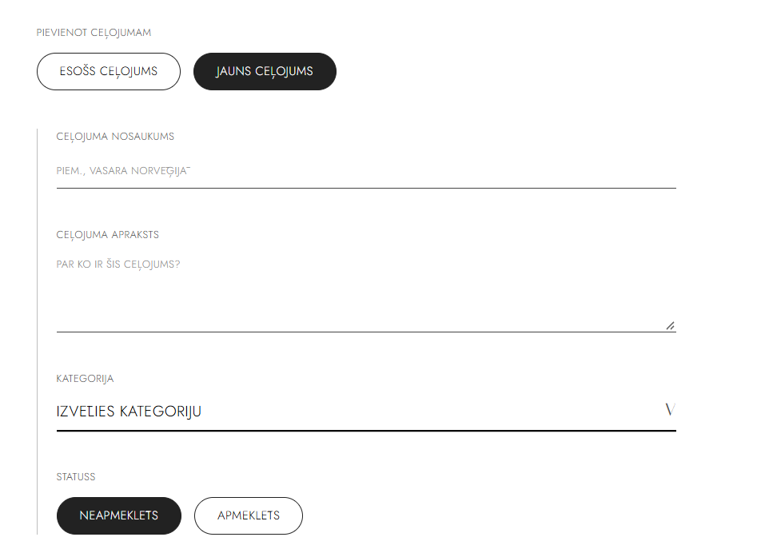
5. **Ceļojuma izvēle** – ja izvēlēts esošs ceļojums, laukā „TAVS CEĻOJUMS” jānorāda vēlamais ceļojums.
6. **Redzamība** – jāizvēlas galamērķa redzamības statuss:
   - **„PRIVĀTS”** – galamērķis ir paredzēts tikai lietotāja personīgajam ceļojumam.
   - **„PUBLISKS”** – galamērķis ir publiski pieejams arī citiem platformas lietotājiem.
7. **Apraksts** – laukā „APRAKSTS” jāievada īss apskates vietas apraksts, piemēram, kāpēc šo vietu ir vērts apmeklēt.

#### **3. Galamērķa saglabāšana**

#### Saglabāšanas soļi:

1. **Informācijas pārbaude** – jāpārliecinās, ka ievadītais galamērķa nosaukums, valsts, pilsēta un pārējā informācija ir pareiza.
2. **Redzamības pārbaude** – jāpārliecinās, ka izvēlēts vēlamais redzamības statuss.
3. **Galamērķa pievienošana** – formas apakšdaļā jānospiež poga **„PIEVIENOT GALAMĒRĶI”**.
4. **Saglabāšana** – galamērķis tiek pievienots izvēlētajam lietotāja ceļojumam.

#### **4. Papildu navigācijas iespējas**

- **„ATPAKAĻ UZ ATKLĀT”** – ļauj atgriezties galamērķu pārlūkošanas sadaļā, nepabeidzot jauna galamērķa izveidi.

## Administratora panelis

Wanderlist platformā lietotājiem ar administratora tiesībām ir pieejams **administrācijas panelis**, kurā iespējams apskatīt platformas kopējo statistiku un pārvaldīt lietotājus un galamērķus.

Administrācijas panelim iespējams piekļūt, galvenajā navigācijas joslā izvēloties sadaļu **„ADMINISTRĒŠANA”**. Šī sadaļa ir pieejama tikai lietotājiem ar administratora tiesībām.

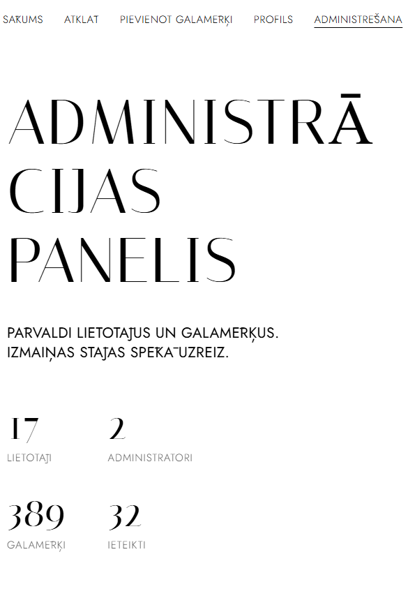
### Administratora statistikas apskate

#### Apskates soļi:

1. **Pieslēgšanās kontam** – administratoram jāpieslēdzas savam Wanderlist kontam.
2. **Administrācijas paneļa atvēršana** – galvenajā navigācijas joslā jāizvēlas sadaļa **„ADMINISTRĒŠANA”**.
3. **Statistikas apskate** – administrācijas paneļa sākumdaļā tiek attēloti četri galvenie platformas statistikas rādītāji:
   - **Lietotāji** – kopējais platformā reģistrēto lietotāju skaits.
   - **Administratori** – kopējais lietotāju skaits, kuriem piešķirtas administratora tiesības.
   - **Galamērķi** – kopējais platformā pievienoto galamērķu skaits.
   - **Ieteikti** – kopējais galamērķu skaits, kuri atzīmēti kā ieteikti.

#### **2. Statistikas atjaunināšana**

Administrācijas panelī attēlotā statistika atspoguļo platformas aktuālos datus.

- **Reģistrējoties jaunam lietotājam**, palielinās kopējais lietotāju skaits.
- **Piešķirot vai noņemot administratora tiesības**, mainās administratoru skaits.
- **Pievienojot vai dzēšot galamērķus**, mainās kopējais galamērķu skaits.
- **Mainoties ieteikto galamērķu skaitam**, tiek atjaunināts ieteikto vietu statistikas rādītājs.


### Lietotāju un galamērķu pārvaldība administrācijas panelī

Wanderlist platformā administratoriem ir iespēja pārvaldīt reģistrētos lietotājus un platformā pieejamos galamērķus. Administrācijas panelī iespējams mainīt lietotāju lomas, dzēst lietotāju kontus, rediģēt un dzēst galamērķus, kā arī atzīmēt galamērķus kā ieteiktus.

Administrācijas panelī ir pieejamas divas galvenās sadaļas – **„LIETOTĀJI”** un **„GALAMĒRĶI”**.

#### **1. Lietotāju pārvaldība**

Sadaļā **„LIETOTĀJI”** administrators var apskatīt visus platformā reģistrētos lietotājus un pārvaldīt to kontus.

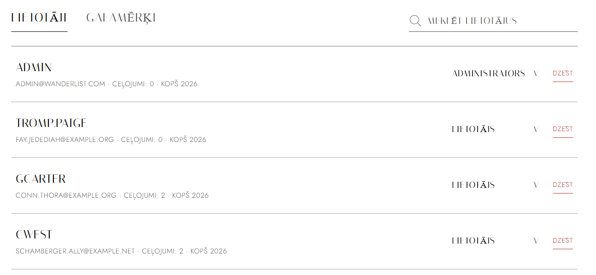

Katram lietotājam tiek attēlota šāda informācija:
- **Lietotājvārds** – lietotāja reģistrētais vārds.
- **E-pasta adrese** – lietotāja kontam piesaistītā e-pasta adrese.
- **Ceļojumu skaits** – lietotāja izveidoto ceļojumu skaits.
- **Reģistrācijas gads** – gads, kurā lietotājs izveidojis kontu.
- **Loma** – lietotāja piekļuves tiesību līmenis.

#### 1.1. Lietotāju meklēšana

1. Administrācijas panelī jāizvēlas sadaļa **„LIETOTĀJI”**.
2. Lapas augšējā labajā pusē jāatrod meklēšanas lauks **„MEKLĒT LIETOTĀJUS”**.
3. Meklēšanas laukā jāievada:
   - **Lietotājvārds** – lai atrastu lietotāju pēc tā vārda.
   - **E-pasta adrese** – lai atrastu lietotāju pēc reģistrētās e-pasta adreses.
   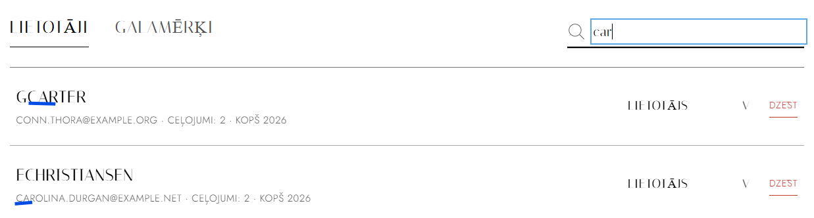
4. Tiek attēloti lietotāji, kuri atbilst ievadītajam meklēšanas tekstam.

#### 1.2. Lietotāja lomas maiņa

Administrators var mainīt lietotāju piekļuves tiesības, piešķirot vai noņemot administratora lomu.

1. Sadaļā **„LIETOTĀJI”** jāatrod lietotājs, kura lomu nepieciešams mainīt.
2. Lietotāja ieraksta labajā pusē jāatver lomas izvēlne.

3. Jāizvēlas viena no pieejamajām lomām:
   - **„LIETOTĀJS”** – standarta lietotāja tiesības.
   - **„ADMINISTRATORS”** – administratora tiesības, kas nodrošina piekļuvi administrācijas panelim.
4. Pēc lomas izvēles lietotāja piekļuves tiesības tiek atjauninātas.

#### 1.3. Lietotāja dzēšana

1. Sadaļā **„LIETOTĀJI”** jāatrod lietotājs, kura kontu nepieciešams dzēst.
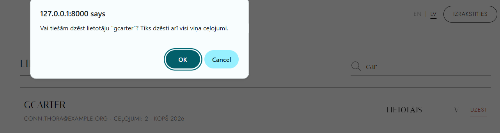
2. Lietotāja ieraksta labajā pusē jānospiež poga **„DZĒST”**.
3. Tiek uzsākts izvēlētā lietotāja konta dzēšanas process.

**Svarīgi:** Lietotāja konta dzēšana ir administratīva darbība, tādēļ pirms tās veikšanas jāpārliecinās, ka izvēlēts pareizais lietotājs.

#### **2. Galamērķu pārvaldība**

Sadaļā **„GALAMĒRĶI”** administrators var apskatīt un pārvaldīt platformā pieejamos galamērķus.

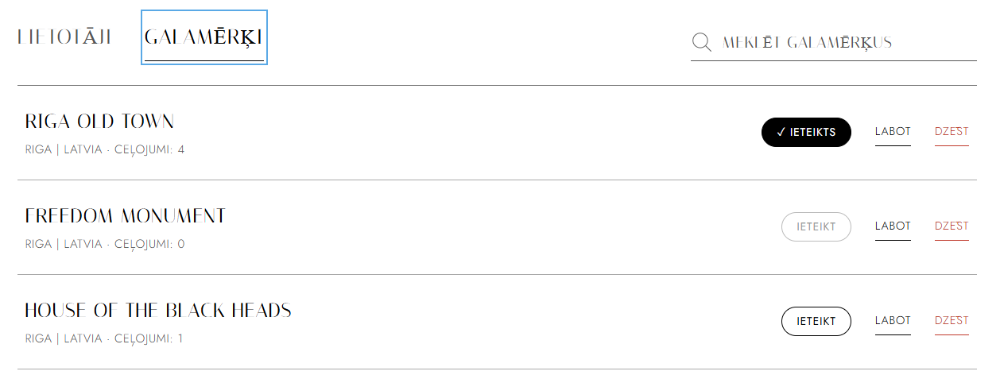

Katram galamērķim tiek attēlota šāda informācija:
- **Galamērķa nosaukums** – apskates vietas nosaukums.
- **Pilsēta** – pilsēta, kurā atrodas galamērķis.
- **Valsts** – valsts, kurā atrodas galamērķis.
- **Ceļojumu skaits** – ceļojumu skaits, kuros konkrētais galamērķis ir iekļauts.
- **Ieteikuma statuss** – norāda, vai galamērķis ir atzīmēts kā ieteikts.

#### 2.1. Galamērķu meklēšana

1. Administrācijas panelī jāizvēlas sadaļa **„GALAMĒRĶI”**.
2. Lapas augšējā labajā pusē jāatrod meklēšanas lauks **„MEKLĒT GALAMĒRĶUS”**.
3. Meklēšanas laukā jāievada viens no kritērijiem:
   - **Valsts** – piemēram, „Latvia”.
   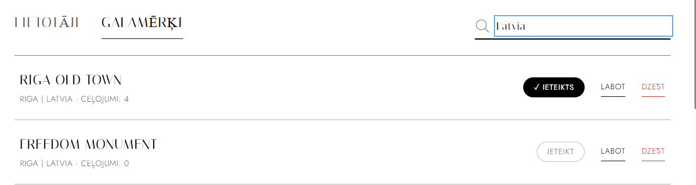
   - **Pilsēta** – piemēram, „Riga”.
    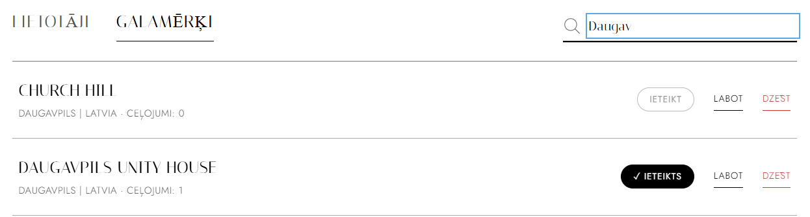
   - **Galamērķa nosaukums** – piemēram, „Freedom Monument”.
    
4. Tiek attēloti galamērķi, kas atbilst ievadītajam meklēšanas tekstam.

#### 2.2. Galamērķa rediģēšana

Administrators var rediģēt platformā pieejamo galamērķu informāciju.

1. Sadaļā **„GALAMĒRĶI”** jāatrod galamērķis, kuru nepieciešams rediģēt.
2. Galamērķa ieraksta labajā pusē jānospiež poga **„LABOT”**.
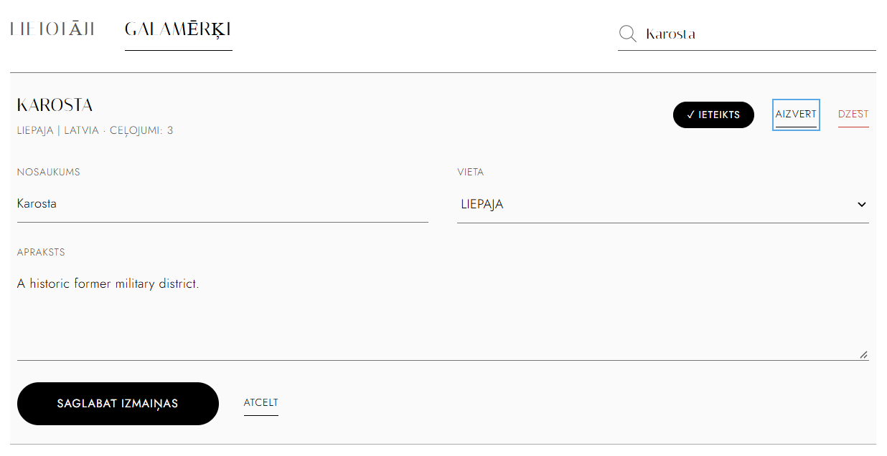
3. Tiek atvērta galamērķa rediģēšanas forma.
4. Jāveic nepieciešamās izmaiņas galamērķa informācijā.
5. Izmaiņas jāsaglabā.

#### 2.3. Galamērķa atzīmēšana kā ieteiktu

Administrators var atzīmēt galamērķus kā ieteiktus, lai izceltu noteiktas apskates vietas platformā.

1. Sadaļā **„GALAMĒRĶI”** jāatrod interesējošais galamērķis.
2. Galamērķa ieraksta labajā pusē jānospiež poga **„IETEIKT”**.
3. Galamērķis tiek atzīmēts kā ieteikts.
4. Ja galamērķis jau ir ieteikts, tā statuss tiek attēlots ar melnu pogu **„✓ IETEIKTS”**.

**Svarīgi:** Iespēja veidot galamērķi par rekomendāciju ir tikai tad ja, galamērķis ir izmantots kādā ceļojumā.

#### 2.4. Galamērķa dzēšana

Administrators var dzēst platformā pieejamos galamērķus.

1. Sadaļā **„GALAMĒRĶI”** jāatrod galamērķis, kuru nepieciešams dzēst.
2. Galamērķa ieraksta labajā pusē jānospiež poga **„DZĒST”**.
3. Tiek uzsākts izvēlētā galamērķa dzēšanas process.

**Svarīgi:** Pirms galamērķa dzēšanas jāpārliecinās, ka izvēlēts pareizais galamērķis, jo tas var būt iekļauts vairāku lietotāju ceļojumos.


